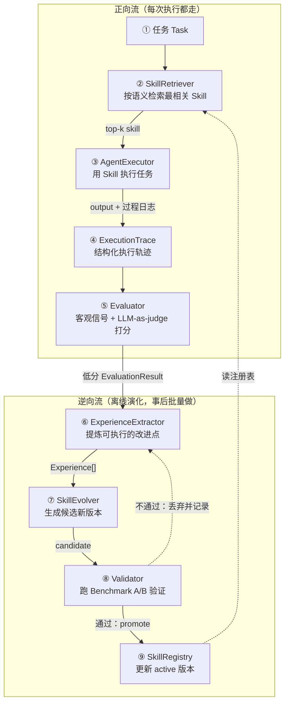

# EvoAgent 系统设计

> 一个「基于执行反馈的自演进 Agent Skill 平台」——第一阶段：架构设计（不含代码实现）。

## 0. 背景与目标

EvoAgent 要解决的问题：普通 LLM Agent 的能力是写死的 prompt，遇到任务不会自己变好；每次执行的经验散落在日志里，无法沉淀、无法复用、无法回滚。

核心闭环：**Task → Skill Retrieval → Agent Execution → Execution Trace → Evaluation → Experience → Skill Evolution → Validation → Skill Registry**。

设计原则（贯穿全文）：
- **本科可理解**：每个模块职责单一、一句话能说清「为什么存在」。
- **本科可实现**：最小依赖（标准库 `sqlite3` + LLM SDK + 可选 numpy），不引入向量数据库 / 编排框架。
- **面试可讲清**：核心是那条闭环，每一环有明确输入输出，能画出数据流图。
- **避免过度工程化**：能用「文件 + SQLite」就不上服务；能用「一次 A/B 跑分」就不做强化学习。

已确认的关键决策：

| 决策点 | 选择 |
|---|---|
| Agent 执行框架 | 纯 Python + 直接调 LLM API（openai/anthropic SDK） |
| Skill 内容 | Prompt 模板 + few-shot 示例 + 工具列表 |
| 评估信号 | 混合：客观结果信号 + LLM-as-judge；客观可判对错时跳过 judge（§7） |
| 持久化 | SQLite 存元数据 / 评分 / trace；Skill 内容本体存 JSON 文件 |
| Skill 范围（v1） | 一次任务只绑定一个 Skill，不做多 Skill 编排（§12） |
| Benchmark 防污染 | benchmark 的 Trace 不进经验挖掘；参考答案永不进 Evolver 上下文（§11） |
| A/B promote 规则 | 平局记 0.5；win_rate ≥ 0.55 且 avg 不降才 promote；regression 不足 20 题转人工（§9/§11） |
| 并发假设 | 单进程单写者（SQLite 开 WAL），演化与执行不并发（§12） |

---

## 1. 核心闭环



**纯文本版（终端里直接看，与上图等价）：**

```
                    ┌───────────────────────────────┐
                    │          闭环（离线/定时）        │
                    └───────────────────────────────┘
 Task 输入
   │
   ▼
┌───────────────┐  top-k skill   ┌───────────────┐
│ SkillRetriever│───────────────►│ AgentExecutor │
└───────────────┘                └──────┬────────┘
   ▲  读注册表                          │ 产出 output + 过程
   │                                    ▼
   │                           ┌──────────────────┐
   │                           │ ExecutionTrace    │
   │                           │ (写 TraceStore)   │
   │                           └────────┬─────────┘
   │                                    ▼
   │                           ┌──────────────────┐
   │                           │ Evaluator        │
   │                           └────────┬─────────┘
   │                                    │ EvaluationResult
   │                                    ▼
   │                           ┌──────────────────┐
   │                           │ Experience       │
   │                           │ Extractor        │
   │                           └────────┬─────────┘
   │                                    │ Experience[]
   │                                    ▼
   │                           ┌──────────────────┐
   │                           │ SkillEvolver     │
   │                           └────────┬─────────┘
   │                                    │ 候选新版本 (draft)
   │                                    ▼
   │                           ┌──────────────────┐
   │                           │ Validator        │
   │                           │ (跑 Benchmark)    │
   │                           └────────┬─────────┘
   │                                    │ 通过 → promote
   │                                    ▼
   └────────────────────────────┌──────────────────┐
                                │ SkillRegistry     │
                                │ (更新 active 版本) │
                                └──────────────────┘
```

一句话：**任务进来 → 检索最合适的 Skill → 执行并记录 Trace → 评估打分 → 提炼经验 → 演化出新版本 → 过 Benchmark 验证 → 更新注册表**。执行是「正向流」，演化是「逆向流」，两条流通过 Trace / EvaluationResult / Experience 三个数据对象衔接。

---

## 2. 系统架构（分层视图）

```
┌──────────────────────────────────────────────────────────┐
│  编排层   EvolutionLoop（主循环/定时器）+ cli.py 入口      │
├──────────────────────────────────────────────────────────┤
│  演化层   SkillEvolver · Validator                        │
├──────────────────────────────────────────────────────────┤
│  评估层   Evaluator · ExperienceExtractor · Benchmark     │
├──────────────────────────────────────────────────────────┤
│  执行层   SkillRetriever · AgentExecutor                  │
├──────────────────────────────────────────────────────────┤
│  存储层   SkillRegistry · TraceStore · EvalStore · storage.py(SQLite/JSON) │
├──────────────────────────────────────────────────────────┤
│  底座     models.py(数据结构) · llm.py(LLM 薄封装) · config │
└──────────────────────────────────────────────────────────┘
```

- 上层只能调下层（或同层），不反向依赖，避免循环 import。
- 数据对象（`models.py` 里的 dataclass）是跨层的「合同」，模块之间只传对象、不传内部实现。
- 存储层是所有持久化操作的唯一入口：`storage.py` 是全项目**唯一写 SQL** 的地方（连接 / 建表 / 通用 CRUD）；`SkillRegistry` / `TraceStore` / `EvalStore` 是领域门面，文件按业务域放在 `skills/` `execution/` `eval/` 包里，但只调 `storage.py`、不 import `sqlite3`。分层是逻辑约束（谁调谁），文件归属按业务域组织。

---

## 3. 核心模块划分

> 每个模块都回答三个问题：**为什么存在 → 职责是什么 → 和谁交互**。

### 3.1 存储层

**SkillRegistry**（`skills/registry.py`）
- **为什么存在**：技能需要一个「唯一可信来源」，否则无法沉淀、无法版本切换、无法回滚。没有注册表，其余全是空中楼阁。
- **职责**：Skill 及其所有版本的增删改查、状态流转、active 指针管理。
- **关键接口**：`register(skill)`、`get(skill_id, version)`、`get_active(skill_id)`、`list(tags=...)`、`promote(skill_id, version)`（设为 active）、`rollback(skill_id, to_version)`（active 指回旧版本，见 §10）、`deprecate(skill_id)`。
- **指标口径**：`metrics` 不做增量回写——使用次数 / 成功率由 traces、evals 表**聚合查询**得出，只有 benchmark 得分作为快照随版本记录。避免冗余存储字段与原始数据失去同步。
- **交互**：被 Retriever（读）、Evolver（写候选）、Validator（读候选/回写状态）、Loop（编排）调用。

**TraceStore**（`execution/trace.py`）
- **为什么存在**：Trace 是「发生了什么」的唯一客观记录，是评估和演化的唯一事实来源。
- **职责**：ExecutionTrace 的写入与查询（按 skill、按时间、按状态过滤）。
- **交互**：被 Executor 写入；被 Evaluator、ExperienceExtractor 读取。

### 3.2 执行层

**SkillRetriever**（`skills/retriever.py`）
- **为什么存在**：任务千变万化，不可能一个 prompt 打天下；要按任务语义挑最相关的 Skill。**检索质量是执行质量的上限**。
- **职责**：`Task → top-k (skill_id, version, score)`。实现分两档：简单版用关键词 / TF-IDF + 余弦；进阶版用 embedding API + 余弦（embedding 按 `skill_id + version` 缓存，检索不重复付费）。加 tag 过滤。
- **无匹配兜底**：top-1 分数低于阈值（如余弦 < 0.3）时不硬塞不相关的 Skill，改用内置 default skill（通用任务提示词），并在 Trace 标记 `retrieval_fallback=True`——这类 Trace 是「该建新 Skill 了」的信号。
- **检索质量度量**：人工标一小批 task → skill 对（约 50 条），离线算 hit@1。「检索质量是执行质量的上限」这句话必须可测，否则无从判断坏在检索还是坏在 Skill。
- **交互**：读 SkillRegistry；被 Loop / CLI 调用。

**AgentExecutor**（`execution/executor.py`）
- **为什么存在**：真正干活的一环，把「用某 Skill 执行某任务」封装成一次**可记录、可重放**的过程，同时是 Trace 的来源。
- **职责**：加载 Skill → 拼 prompt（模板填充 + few-shot + 工具声明）→ 跑最简 agent loop（LLM → 工具调用 → 观察 → LLM → …直到产出最终答案或超步数）→ 全程写 Trace。
- **错误分类**：Trace 的失败必须区分 `error_type`——`infra`（网络 / 限流 / API 故障）与 `task`（技能本身导致，如 `max_steps`、工具用错）。infra 错误不计入演化触发、不进经验挖掘，否则 API 抖动会污染演化信号。
- **工具边界**：Skill 的 `tools` 只能从 `tools.py` 预注册工具箱里**选子集**，不能发明新工具；加载 Skill 时校验工具名，未注册直接报错。文件类工具限定在 `data/workspace/` 目录内（沙箱），演化出的 Skill 也逃不出这个边界。
- **交互**：读 SkillRegistry（取具体版本内容）；写 TraceStore；被 Loop 调用。

### 3.3 评估层

**Evaluator**（`eval/evaluator.py`）
- **为什么存在**：执行完不能凭感觉；要把一次执行变成一个**可比较的「分数 + 结论」**，给演化提供梯度。没有它，演化就是瞎改。
- **职责**：`(Trace, Task, 可选参考答案) → EvaluationResult`。混合两层（见 §7）。
- **交互**：读 TraceStore；读 Benchmark（拿 rubric/参考答案）；写 EvaluationResult；被 ExperienceExtractor、Validator 复用。

**ExperienceExtractor**（`eval/experience.py`）
- **为什么存在**：一条 Trace 可能有几十步工具调用、很乱，演化器不能直接吃。需要中间层把「这次为什么差/好」**提炼成可执行的改进点**。
- **职责**：`(Trace, EvaluationResult) → Experience[]`。每条经验定位到 Skill 的某个部分 + 给具体改法。
- **交互**：读 Evaluator 结果；输出给 SkillEvolver。

**Benchmark / Eval Suite**（`eval/benchmark.py`）
- **为什么存在**：需要一把客观、可重复的「尺子」来衡量 Skill 好坏，否则 Validator 无法判断新版本是变好还是变坏。
- **职责**：维护一组带参考答案/rubric 的任务，支持按 tag/difficulty 抽取；跑一批任务返回汇总得分（见 §11）。
- **交互**：被 Validator 调用。

### 3.4 演化层

**SkillEvolver**（`evolution/evolver.py`）
- **为什么存在**：「自演进」的核心。把经验变成**新版本的 Skill**。
- **职责**：`(旧 Skill, Experience[]) → 候选新版本`（新的 prompt/示例/工具 + change_log + 新版本号）。改工具列表时只能从预注册工具箱**选子集**（同 §3.2 Executor 约束）；输入中**永不出现** benchmark 参考答案 / rubric（防污染，见 §11）。
- **交互**：读 SkillRegistry（旧版本）；输出候选版本给 Validator。

**Validator**（`evolution/validator.py`）
- **为什么存在**：演化可能「改坏」。任何新版本上线前必须过 Benchmark，**防止回归**。
- **职责**：拿候选版本跑 Benchmark，与旧版本 A/B；通过 → promote 到 Registry（旧版本自动 deprecated、保留历史），不通过 → 丢弃并记录失败原因。
- **交互**：读 Benchmark；调 Executor + Evaluator 跑测试；回写 SkillRegistry。

### 3.5 编排层

**EvolutionLoop**（`evolution/loop.py`）
- **为什么存在**：上面每个模块只管一段，需要一个「主循环」把它们串成闭环，并控制**什么时候演化**（成本控制）。
- **职责**：按触发条件（见 §9）收集低分 Trace → 按 skill 聚合 → 提炼经验 → 演化 → 验证 → 更新注册表。
- **交互**：调用其余所有模块；是系统的「神经系统」。

---

## 4. 数据流设计

**正向流（运行时，每次执行都走）**
1. `Task` 进入 CLI/Loop，打来源标签 `task_source`（`real` = 真实任务 / `benchmark` = 跑分），标签随 Trace 贯穿全链路（防污染的关键，§11）
2. `SkillRetriever.retrieve(task)` → top-1（默认）active Skill；相似度低于阈值时走 default skill 兜底（§3.2）
3. `AgentExecutor.run(task, skill)` → 最终输出 + `ExecutionTrace`（写 TraceStore；失败时标 `error_type`，区分 infra / task）
4. `Evaluator.evaluate(trace, task)` → `EvaluationResult`（写 DB）。成本规则（§7）：客观信号可判对错时跳过 judge；既无客观信号又无 rubric 时只记分数、`passed=None`
5. 若 `passed is False`（None 表示不可判，不算）且 `error_type != "infra"` 且 `task_source == "real"` → 标记为「待演化候选」，供离线演化使用

**逆向流（演化，离线/定时触发）**
6. `EvolutionLoop` 收集最近 N 条低分 Trace（只收 `task_source == "real"`，排除 infra 错误），按 skill_id 分组
7. `ExperienceExtractor` 对每组 → `Experience[]`
8. `SkillEvolver` 对每个待改进 skill → 候选新版本（status=draft）
9. `Validator` 跑 Benchmark 得新旧版本分数 → A/B 决策（同批配对跑；平局记 0.5，`win_rate >= 0.55` 且 `avg_score` 不降才通过，详见 §9/§11）
10. 通过 → `SkillRegistry.promote`（新版本 active，旧版本 deprecated）；不通过 / 不显著 → 丢弃并记录失败演化（§9）；题数不足 → 候选转人工确认

**关键点**：正向流和逆向流解耦 —— 执行时**不做任何演化**，演化永远在事后批量做。这样执行路径短、可预测，演化可以慢慢做、可重试、可回滚。

---

## 5. Skill 数据结构

```python
# models.py —— 所有结构用 dataclass 表达，方便序列化与测试
@dataclass
class FewShot:
    input: str
    output: str

@dataclass
class ToolSpec:
    name: str
    description: str
    parameters: dict        # JSON Schema，描述入参

@dataclass
class Skill:
    skill_id: str           # 稳定标识，跨版本不变，如 "code-review"
    name: str
    description: str        # 语义描述，供检索用
    version: str            # "1.3.2"（见 §10）
    tags: list[str]         # ["code","python"]
    prompt_template: str    # 系统提示词模板，含 {task} 等占位符
    few_shots: list[FewShot]        # 输入-输出示例
    tools: list[ToolSpec]           # 可用工具声明
    status: str             # draft / candidate / active / deprecated
    parent_version: str     # 由哪个版本演化而来（溯源）
    change_log: str         # 本版本改了什么
    metrics: dict           # 仅 benchmark 得分快照；使用次数/成功率由 traces/evals 聚合查询（§3.1）
    created_at: str
    updated_at: str
```

持久化映射：
- **SQLite 表 `skills`**：存 `skill_id, version, status, parent_version, change_log, metrics, timestamps`（元数据，好查询）。
- **JSON 文件 `data/skills/{skill_id}/{version}.json`**：存 `prompt_template, few_shots, tools`（内容本体，方便人工看 / git diff）。

**为什么这样分**：元数据要频繁查询/统计（放进 SQLite），内容本体要人工 review 和 diff（放 JSON + git）。两者靠 `skill_id + version` 关联。

---

## 6. Execution Trace 数据结构

```python
@dataclass
class TraceStep:
    step_index: int
    type: str               # "llm_call" | "tool_call" | "tool_result" | "final"
    content: str            # 消息/工具参数/观察结果
    tool_name: str = ""
    tokens: int = 0
    latency_ms: int = 0

@dataclass
class ExecutionTrace:
    trace_id: str
    task_id: str
    task_source: str        # "real"（真实任务）| "benchmark"（跑分）——防污染的关键标签（§11）
    skill_id: str
    skill_version: str
    started_at: str
    ended_at: str
    steps: list[TraceStep]
    final_output: str
    status: str             # success / error / timeout / max_steps
    error: str = ""
    error_type: str = ""    # "" | "infra"（网络/限流，与技能无关）| "task"（技能导致，§3.2）
    retrieval_fallback: bool = False   # 检索无匹配、走了 default skill（§3.2）
    usage: dict = None      # {total_tokens, total_cost, total_latency_ms}
```

持久化：SQLite 表 `traces`（一行一次执行，存汇总字段）+ 表 `trace_steps`（一行一步，外键 trace_id）。`content` 超过 4000 字符截断存储并置 `truncated=True`，防单步超大工具输出撑爆数据库。

**为什么 Trace 要细到 step 级**：Evaluator 和 ExperienceExtractor 都要「定位到哪一步出了问题」（是工具用错了？还是 prompt 没写清楚？）。只有摘要没法做精准演化。

---

## 7. Evaluator 设计

混合两层，**客观优先、主观兜底**：

**第一层：客观信号（Objective Scorer，零成本、可复现）**
- 执行状态：`status == "error"` 或 `"timeout"` → 直接判低分/失败。
- 判题信号：若 Benchmark 提供了 `objective_check`（`exact` / `contains` / `test_script`），直接用规则判对错，无需 LLM。

**第二层：主观信号（LLM-as-judge）**
- 用**与执行不同的另一个模型**当裁判（同模型有自偏好偏差），输入「任务 + 执行输出 + rubric」，要求输出**结构化 JSON**：`{分项分数, 理由}`。
- rubric 分项示例：`correctness`（正确性）、`completeness`（完整性）、`format`（格式/可读性）、`follow_skill`（是否遵循 Skill 指引）。
- 稳定性要点：temperature=0、强制 JSON 输出（`response_format` 或解析兜底）、分项打分 0~5；A/B 对比时新旧版本**同批配对**评测，抵消 judge 分数随时间的漂移（§9）。
- **跳过规则（前向流的成本边界）**：客观信号已能判对错（`exact` / `test_script`）→ 不跑 judge；客观已 fail → 直接 fail。judge 只用于开放题细分和 `contains` 这类半信号兜底——否则每次执行都多付一次裁判的钱，违背「执行路径短」的设计。

**融合（按可用信号降级，权重不留悬空）**：

```
有客观信号 + rubric:  total_score = 0.7 * objective_score + 0.3 * judge_score
只有 rubric:          total_score = judge_score
两者皆无（用通用 rubric 凑合打分）:
                      只记分数，passed = None —— 分数噪声大，不判对错、不触发演化
passed 判定:          total_score >= threshold（默认 0.6），仅上面前两种情况生效
```

```python
@dataclass
class EvaluationResult:
    eval_id: str
    trace_id: str
    eval_basis: str             # "objective"（客观已判，跳过 judge）/ "mixed" / "judge_rubric" / "judge_generic"
    passed: bool | None         # None = 无客观信号且无 rubric，不可判对错，不参与演化触发
    total_score: float          # 0~1
    objective: dict             # {status, matched, test_pass, ...}
    judge_score: float          # 0~1；跳过 judge 时记 0
    rubric_scores: dict         # {correctness: 0.8, completeness: 0.6, ...}
    judge_reason: str
    evaluated_at: str
```

**为什么客观优先**：LLM-as-judge 贵且不稳定；能用规则/测试判的就不用 LLM。客观失败直接 fail，主观只用于开放题的细分。这样 Benchmark 才跑得动、跑得可复现。

---

## 8. Experience 数据结构

闭环里的「Experience」虽然没被单独点名，但它是 Trace → Evolution 的必要桥梁，补上：

```python
@dataclass
class Experience:
    experience_id: str
    trace_id: str
    skill_id: str
    category: str       # "missing_step" | "wrong_instruction" |
                        # "bad_example" | "tool_misuse" | "hallucination" | "good_pattern" |
                        # "failed_evolution"（上次演化失败复盘，见 §9）
    summary: str        # 一句话结论，如「工具入参说明不清楚，导致 agent 少传一个参数」
    target_section: str # 定位到 prompt_template / few_shots / tools 哪一块
    suggestion: str     # 具体改法
    confidence: float   # 0~1
```

**为什么 category + target_section 要结构化**：Evolver 需要知道「改哪里、怎么改」，而不是吃一段模糊的反思文字。结构化后可以按类别聚合、按置信度过滤，避免噪声经验污染 Skill。

---

## 9. Skill Evolution 流程

**触发条件（避免每条 trace 都演化，控制成本与噪声）**
- 定时：每 N 次执行后 / 每天离线跑一次；或
- 阈值：某 skill 连续 M 次 `passed is False`。
- **计数口径**：只统计 `task_source == "real"`、`error_type != "infra"`、`passed is False` 的执行——benchmark 跑分、API 抖动、不可判定的分数都不算，防止基础设施故障被当成「技能变差」。

**演化步骤**
1. **聚合**：取该 skill 最近 K 条低分 Trace + 若干高分 Trace 做对照（正反例），只取 `task_source == "real"` 的 Trace（防污染，§11）。
2. **提炼**：ExperienceExtractor 用 LLM 对比好/坏 Trace → `Experience[]`（问题定位 + 建议），按 `confidence` 过滤低置信度。
3. **生成候选**：SkillEvolver 把经验应用到旧 Skill → 新 `prompt_template / few_shots / tools`，输出 `change_log` + 新版本号（status=candidate）。
4. **验证**：Validator 用 Benchmark 跑新旧版本**同批配对** A/B（同时段、同 judge 模型、temperature=0，抵消 judge 分数随时间漂移）。promote 条件：
   - 平局记 0.5；`win_rate >= 0.55` **且** `avg_score` 不下降 → 通过；
   - `win_rate` 落在 (0.5, 0.55) → **不显著**，按不通过处理（宁可慢，不让噪声驱动进化）；
   - 该 skill 的 regression 集不足 20 题 → 不自动 promote，候选留在 candidate 状态**转人工确认**（§11）。
5. **决策**：
   - 通过 → `SkillRegistry.promote`（新版本 active，旧版本 deprecated，历史保留）。
   - 不通过 / 不显著 → 丢弃候选，写一条 `category="failed_evolution"` 的 Experience（候选 diff 摘要 + 失败指标）。
   - **失败经验怎么被用掉**：下次演化同一 skill 时，Evolver 输入附**最近一条**失败演化摘要（截断到固定长度），避免重蹈覆辙；更早的只存档供人工查看，不无限堆进上下文。

**防退化机制**：任何演化必须过 Validator 才能上线；历史版本永存、active 指针可回滚。

**成本控制**：演化只对「低分且样本量够」的 skill 触发；每次演化限 LLM 调用次数；失败的候选直接丢，不反复重试。

---

## 10. Skill Versioning 方案

- **版本号**：SemVer 风格 `major.minor.patch`
  - `patch`：措辞微调、单个示例微调
  - `minor`：新增/删除步骤或示例、改工具列表
  - `major`：结构大改（如换整体框架）
  - 实际由 Evolver 提议 + 规则按 diff 大小自动判定（可留人工确认口子）。
- **不可变历史**：每个版本一条记录，**永不原地改**；「改」= 新建版本。
- **溯源链**：`parent_version` + `change_log` 构成线性历史，可追溯、可解释。
- **状态机**：`draft → candidate → active → deprecated`，外加一条回滚专用边 `deprecated → active`（只允许 `rollback()` 走）；同一 skill 同一时刻**只有一个 active**。
- **回滚**：`SkillRegistry.rollback(skill_id, to_version)` 把 active 指回旧版本、当前 active 转 deprecated——`promote` 的镜像操作。
- **版本号唯一性**：演化由单进程 Loop 串行驱动（§12），同一 parent 同时只有一个候选，不会撞版本号——这依赖单写者假设，因此不需要引入锁。
- **存储**：SQLite 存版本记录（含 status/parent/metrics），JSON 文件归档内容；git 追踪 JSON，天然得到可视化 diff。

**为什么不用 git 当版本系统**：git 管的是「代码」，这里要的是「可查询的版本元数据 + 运行时状态 + 指标」。两者结合：git 负责内容 diff，SQLite 负责运行态。

---

## 11. Benchmark / Eval 方案

**构建来源**
- 人工标注少量核心场景（golden set，覆盖主要 skill 的典型任务 + 参考答案/rubric）。
- 从历史执行沉淀：把有明确客观成功信号的 Trace 转成 benchmark task（「自举」，越用越全）；自举题目**必须人工审核**后才入库，且入库后其对应的历史 Trace 不再参与经验挖掘。

**防污染规则（闭环成立的前提，面试必问）**
经验挖掘（§9）和 benchmark（本节）一旦串通，Evolver 就可能「背题」——win_rate 涨了但不是泛化。三条硬规则：
1. **来源隔离**：Trace 带 `task_source` 标签，`benchmark` 来源的 Trace 永不进经验挖掘；经验只来自真实任务的失败。
2. **答案隔离**：参考答案 / rubric 永不出现在 Evolver 的任何输入里；它只见 Experience（改进建议），不见考卷。
3. **extension set 只考不学**：extension set 仅用于验证，永不以任何形式进入经验或演化上下文——它是衡量「有没有过拟合 regression set」的那把尺子。

**划分**
- `regression set`：演化后必跑，防止改坏已有能力。
- `extension set`：新场景，衡量泛化。

**指标**（每个 skill 单独统计）
- `success_rate`：客观通过率
- `avg_total_score`：Evaluator 融合分均值
- `win_rate`：同任务 A/B，新版本得分更高记 1、持平记 0.5、更低记 0；promote 阈值见 §9（≥ 0.55 且 avg 不降）
- **最小题数**：每个 skill 的 regression 集不少于 20 题（目标 30）；不足则该 skill 的候选不自动 promote、转人工确认——小样本上的 win_rate 只是噪声。

**运行时机**：演化验证必跑 regression；支持手动全量回归。

**报告**：每次跑产出 `report.json` / `report.md`（各 skill 分数、A/B 对比、失败任务明细），纳入 git 追踪，方便「看演进曲线」。

```python
@dataclass
class BenchmarkTask:
    task_id: str
    task: str                  # 任务描述
    reference_answer: str = "" # 参考答案（可选）
    rubric: list[str]          # 评分维度
    objective_check: dict      # {"type": "exact"|"contains"|"test_script", "value": ...}
    tags: list[str]
    difficulty: str            # easy / medium / hard
```

---

## 12. 冷启动、范围与运行假设

**范围声明（v1 明确不做的事，堵住追问）**
- 一次任务只绑定一个 Skill：不做多 Skill 编排 / 组合 / 规划（v2 方向，先把单 Skill 的演化闭环做扎实）。
- 单用户单进程：不做鉴权、多租户、服务化。

**冷启动：种子技能从哪来**
系统第一天没有任何 Skill，检索和演化都是空转。种子技能由人工撰写 v1.0.0，示例：

| 种子技能 | 覆盖场景 | 用到的工具 |
|---|---|---|
| `code-review` | 给代码提 review 意见 | file_rw（只读） |
| `text-summarize` | 长文摘要 | 无 |
| `qa-with-tools` | 要查资料 / 算数的问答 | search / calculator |

每个种子技能必须带**三件套**才算合格：清晰的 `description` + tags（供检索）、至少 2 条 few-shot、对应 regression 集 ≥ 20 题（§11）。没有 regression 集的技能不允许注册——**不能被验证的技能不该上线**，这条从第一天就成立。

**演示流量从哪来（作品集项目特有问题）**
闭环要靠真实任务流量喂经验，但拿 benchmark 题当日常负载会踩 §11 的污染红线。两个干净来源：
- **公开数据集切半**：一半当 workload（补上 `objective_check`，按 `real` 任务跑），另一半做 golden set；workload 半区日后可自举入库（需人工审核），golden 半区永远只考不学。
- **手动喂任务**：`cli.py run` 跑自己真实遇到的任务，量少但 100% 真实。

**运行假设（显式写出来，不靠隐式依赖）**
- 单进程单写者：SQLite 开 WAL；演化与执行不并发（定时任务串行触发），因此无锁、不需要并发改造。
- 演化永远离线批量做：正向流不含任何演化动作（§4），这是全系统最重要的成本与安全边界。

---

## 13. 目录结构（细化到具体文件）

```text
evoagent/
├── README.md                          # 项目说明 + 快速上手
├── pyproject.toml                     # 包元信息 + 依赖声明
├── requirements.txt                   # openai / anthropic / numpy / pytest
│
├── evoagent/                          # ── 核心源码包 ──
│   ├── __init__.py
│   ├── config.py                      # 底座：路径、阈值、LLM 参数（threshold / weights）
│   ├── models.py                      # 底座：全部 dataclass 数据结构
│   │                                  #   Skill / FewShot / ToolSpec（§5）
│   │                                  #   ExecutionTrace / TraceStep（§6）
│   │                                  #   EvaluationResult（§7）/ Experience（§8）
│   │                                  #   BenchmarkTask（§11）
│   ├── storage.py                     # 存储底座：连接/建表/通用 CRUD
│   │                                  #   （全项目唯一写 SQL 的地方，§2）
│   ├── llm.py                         # 底座：LLM 薄封装（provider 可插拔）
│   │                                  #   class LLMClient.complete() / chat_json()
│   │
│   ├── skills/                        # ── 执行层：技能检索与管理 ──
│   │   ├── __init__.py
│   │   ├── registry.py                # class SkillRegistry（版本状态机 + active 指针，走 storage.py）
│   │   └── retriever.py               # class SkillRetriever（task → top-k skill）
│   │
│   ├── execution/                     # ── 执行层：实际运行 ──
│   │   ├── __init__.py
│   │   ├── executor.py                # class AgentExecutor（agent loop：LLM ↔ 工具）
│   │   ├── trace.py                   # class TraceStore（Trace 写入/查询，走 storage.py）
│   │   └── tools.py                   # 内置工具注册（search / calculator / file_rw 限沙箱目录）
│   │
│   ├── eval/                          # ── 评估层 ──
│   │   ├── __init__.py
│   │   ├── store.py                   # class EvalStore（evals / experiences 表门面，走 storage.py）
│   │   ├── evaluator.py               # class Evaluator（客观信号 + LLM-as-judge）
│   │   ├── experience.py              # class ExperienceExtractor（trace → Experience[]）
│   │   └── benchmark.py               # class Benchmark（BenchmarkTask 加载 + 运行汇总）
│   │
│   ├── evolution/                     # ── 演化层 ──
│   │   ├── __init__.py
│   │   ├── evolver.py                 # class SkillEvolver（旧 skill + experience → 候选版本）
│   │   ├── validator.py               # class Validator（跑 benchmark A/B，promote / 回滚）
│   │   └── loop.py                    # class EvolutionLoop（主循环编排）
│   │
│   └── cli.py                         # 入口：run / evolve / bench / list 子命令
│
├── data/                              # ── 运行时数据（持久化）──
│   ├── evoagent.db                    # SQLite：skills / traces / trace_steps / evals 表
│   ├── skills/                        # skill 内容 JSON 归档
│   │   └── {skill_id}/{version}.json  #   如 code-review/1.0.0.json；含 _default/（检索兜底技能，§3.2）
│   ├── benchmarks/                    # benchmark 任务集
│   │   ├── regression.json            #   回归集（演化必跑）
│   │   └── extension.json             #   扩展集（衡量泛化）
│   └── workspace/                     # file_rw 工具的沙箱目录（§3.2）
│
└── tests/                             # ── 单元测试 ──
    ├── test_models.py                 # 数据结构 序列化/反序列化
    ├── test_storage.py                # Storage 底座 + 版本状态机读写
    ├── test_retriever.py              # 检索
    ├── test_executor.py               # 执行（用 mock LLM，不发真实请求）
    ├── test_evaluator.py              # 评估（客观 + judge）
    ├── test_benchmark.py              # benchmark 运行与汇总
    └── test_evolution.py              # 演化 + 验证闭环（用 mock LLM）
```

**文件 → 模块/类 对应表（新手速查）**

| 模块 | 所在文件 | 核心类/函数 | 一句话职责 |
|---|---|---|---|
| 数据结构 | `evoagent/models.py` | `Skill` `ExecutionTrace` `Experience` … | 定义所有「传什么数据」 |
| LLM 底座 | `evoagent/llm.py` | `LLMClient` | 屏蔽不同 provider 的差异 |
| 配置 | `evoagent/config.py` | 常量 | 阈值、权重、路径集中管理 |
| 存储底座 | `evoagent/storage.py` | `Storage` | 全项目唯一写 SQL 的地方（连接/建表/CRUD） |
| 注册表 | `evoagent/skills/registry.py` | `SkillRegistry` | 技能的版本管理 + active 指针（走 Storage） |
| 检索器 | `evoagent/skills/retriever.py` | `SkillRetriever` | 任务 → 最相关 skill |
| 执行器 | `evoagent/execution/executor.py` | `AgentExecutor` | 跑 agent loop，产出 Trace |
| 工具 | `evoagent/execution/tools.py` | 内置工具 | 给 agent 提供可调用工具（Skill 只能选子集，§3.2） |
| Trace 存储 | `evoagent/execution/trace.py` | `TraceStore` | Trace 写入/查询（走 Storage） |
| 评估存储 | `evoagent/eval/store.py` | `EvalStore` | evals / experiences 读写（走 Storage） |
| 评估器 | `evoagent/eval/evaluator.py` | `Evaluator` | 客观 + LLM-as-judge 打分 |
| 经验提炼 | `evoagent/eval/experience.py` | `ExperienceExtractor` | trace → 改进点 |
| 基准 | `evoagent/eval/benchmark.py` | `Benchmark` | 维护并运行考试任务集 |
| 演化器 | `evoagent/evolution/evolver.py` | `SkillEvolver` | 经验 → 候选新版本 |
| 验证器 | `evoagent/evolution/validator.py` | `Validator` | benchmark A/B，promote/回滚 |
| 编排器 | `evoagent/evolution/loop.py` | `EvolutionLoop` | 串起整条闭环 |

---

## 14. 技术选型汇总（最小依赖）

| 项 | 选择 | 理由 |
|---|---|---|
| 语言 | Python 3.10+ | 本科生主流 |
| LLM | openai / anthropic SDK，`llm.py` 薄封装 | 可插拔、依赖少 |
| 数据库 | `sqlite3`（标准库） | 零部署、好查询、好调试 |
| 检索 | 简单版 TF-IDF/关键词 + 余弦；进阶版 embedding API + numpy | 不引入向量数据库（过度工程） |
| 数据结构 | `dataclasses` | 序列化 + 类型提示 + 易测试 |
| 测试 | `pytest` | 标准 |
| 并发模型 | 单进程单写者（SQLite 开 WAL） | 演化/执行不并发，零锁复杂度（§12） |

---

## 15. 怎么把这件事讲清楚（面试抓手）

1. **一句话**：我把 Agent 的能力拆成「可版本化、可检索、可评估、可演化」的 Skill，用一条闭环让技能自己变好。
2. **画闭环图**（§1 那张）并指出：正向流执行、逆向流演化，用 Trace/Evaluation/Experience 三个数据对象衔接。
3. **四个难点**（也是最容易被追问、要能答的）：
   - **梯度从哪来** → Evaluator 的混合信号（客观优先、LLM-as-judge 兜底；无客观信号且无 rubric 时不判 pass）。
   - **怎么防止改坏** → Validator + Benchmark A/B（平局记 0.5、win_rate ≥ 0.55 才 promote、题数不足转人工）+ 版本不可变历史可回滚。
   - **怎么证明不是噪声 / 过拟合** → 防污染三规则（来源隔离、答案隔离、extension 只考不学）+ 同批配对 A/B + 不显著不 promote。
   - **成本怎么控** → 演化只在低分且样本够时批量触发；客观可判时跳过 judge；执行时零演化开销。
